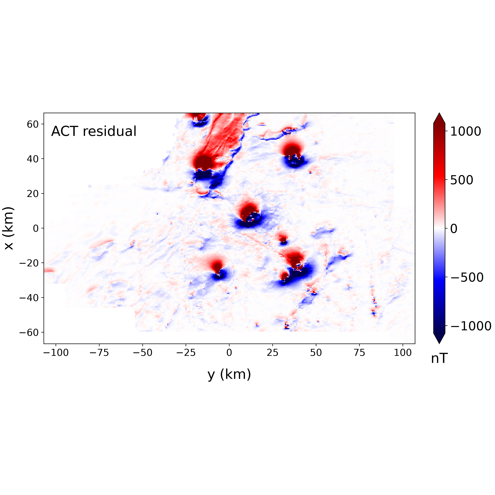

# Transformacoes-campos-potenciais

[Vanderlei C. Oliveira Jr.](http://lattes.cnpq.br/4332841435949533)
Pesquisador Titular
Coordenação de Geofísica
Observatório Nacional

O presente repositório contém os slides da apresentação que realizei no dia 4 de Novembro de 2026, no Ciclo de Seminários do [Programa de Pós-Graduação em Geofísica do ON](https://www.gov.br/observatorio/pt-br/assuntos/programas-academicos/pos-graduacao-em-geofisica).

